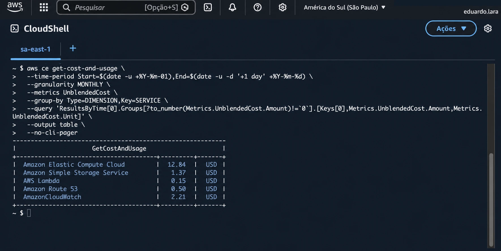

# Consultar custos AWS pelo CloudShell


[](LICENSE)

Consulte os custos disponíveis do mês atual da sua conta AWS, agrupados por serviço, diretamente pelo AWS CloudShell.

Este projeto é referência do nosso artigo **[Como consultar os custos da AWS pelo CloudShell](https://www.vocecertificado.com.br/consultar-custos-aws-cloudshell/)**, do blog da Você Certificado®.

## Como funciona

Você executa o comando `aws ce get-cost-and-usage` no CloudShell. O AWS CLI consulta a API do Cost Explorer e apresenta o resultado em uma tabela no terminal.

- Período: primeiro dia do mês atual até o dia atual, usando datas em UTC.
- Agrupamento: serviço AWS (`SERVICE`).
- Métrica: custo não combinado (`UnblendedCost`).
- Filtro de apresentação: exibe somente valores diferentes de zero, incluindo eventuais valores negativos.
- Colunas: serviço, valor e moeda retornada pela API.

O endpoint do Cost Explorer utilizado está em `us-east-1`. Isso **não limita a consulta aos custos dessa região**. O comando não aplica filtro por região.

## Pré-requisitos

- Uma conta AWS com acesso ao CloudShell.
- AWS Cost Explorer habilitado.
- A identidade utilizada deve ter permissão para consultar o Cost Explorer, incluindo a ação `ce:GetCostAndUsage`.

O CloudShell já disponibiliza o AWS CLI e as credenciais da sessão do console. Não é necessário instalar ferramentas nem configurar chaves de acesso para executar este exemplo.

Após habilitar o Cost Explorer pela primeira vez, os dados do mês atual podem levar cerca de 24 horas para aparecer. Restrições da conta ou do AWS Organizations também podem afetar o acesso aos dados.

## Custos

O AWS CloudShell não tem cobrança adicional pelo seu uso padrão. A API do Cost Explorer cobra por solicitação paginada, portanto cada execução pode gerar cobrança. Uma execução pode envolver mais de uma solicitação devido à paginação automática do AWS CLI.

Consulte os valores vigentes na [página de preços do AWS Cost Explorer](https://aws.amazon.com/aws-cost-management/aws-cost-explorer/pricing/) e as [informações de preços do CloudShell](https://docs.aws.amazon.com/cloudshell/latest/userguide/welcome.html#pricing).

## Como executar

### 1. Abra o AWS CloudShell

Acesse o Console de Gerenciamento da AWS e abra o **CloudShell**. Utilize o terminal Bash padrão.

### 2. Copie e execute o comando

Copie o bloco completo abaixo, cole no CloudShell e pressione **Enter**:

```bash
hoje=$(date -u +%Y-%m-%d)
inicio="${hoje:0:7}-01"
fim=$(date -u -d "$hoje +1 day" +%Y-%m-%d)

aws ce get-cost-and-usage \
  --region us-east-1 \
  --time-period "Start=$inicio,End=$fim" \
  --granularity MONTHLY \
  --metrics UnblendedCost \
  --group-by Type=DIMENSION,Key=SERVICE \
  --query 'ResultsByTime[].Groups[?to_number(Metrics.UnblendedCost.Amount)!=`0`].[Keys[0],Metrics.UnblendedCost.Amount,Metrics.UnblendedCost.Unit][]' \
  --output table \
  --no-cli-pager
```

O período é calculado automaticamente a cada execução. A data final enviada à API é o dia seguinte, pois o parâmetro `End` é exclusivo. Assim, a consulta inclui os dados disponíveis do dia atual.

### 3. Confira o resultado

Veja na tabela quais serviços apresentam valores diferentes de zero. As colunas mostram, nesta ordem, o nome do serviço, o valor e a moeda.

## Resultado esperado

Uma tabela com os serviços que possuem custos diferentes de zero no período consultado.

<p align="center">
  
</p>

Os valores e serviços exibidos dependem dos dados disponíveis para a sua conta. Se não houver valores diferentes de zero, a consulta pode não apresentar linhas de serviços.

## Como interpretar o resultado

- Os dados não são atualizados em tempo real e podem mudar durante o mês.
- A consulta apresenta custos por serviço. Ela não lista recursos ativos nem identifica individualmente os recursos responsáveis pelas cobranças.
- `UnblendedCost` representa o custo não combinado. Não corresponde à métrica de custo amortizado.
- Na conta de gerenciamento de uma organização, os resultados podem incluir custos das contas-membro, conforme o acesso disponível.
- Os valores do mês em andamento podem ser estimados e não representam necessariamente o valor final da fatura.

## Problemas comuns

| Situação | O que verificar |
| --- | --- |
| `AccessDeniedException` | Confirme se sua identidade tem permissão para consultar o Cost Explorer e se existem restrições na conta ou organização. |
| Dados ainda indisponíveis | Confirme se o Cost Explorer está habilitado e aguarde a preparação inicial dos dados. |
| Tabela sem serviços | Pode não haver valores diferentes de zero no período, ou os dados ainda podem estar em atualização. |
| Erro no comando `date` ao executar localmente | O comando foi preparado para o ambiente Linux do AWS CloudShell, que utiliza GNU date. |

## Limpeza

Não é necessário executar comandos de limpeza. A consulta apenas lê os dados do Cost Explorer e apresenta o resultado no terminal, sem criar recursos nos serviços consultados ou baixar arquivos.

## Referências

- [Artigo: Como consultar os custos da AWS pelo CloudShell](https://www.vocecertificado.com.br/consultar-custos-aws-cloudshell/)
- [AWS CLI: get-cost-and-usage](https://docs.aws.amazon.com/cli/latest/reference/ce/get-cost-and-usage.html)
- [API do AWS Cost Explorer e endpoint](https://docs.aws.amazon.com/cost-management/latest/userguide/ce-api.html)
- [Habilitar o Cost Explorer](https://docs.aws.amazon.com/cost-management/latest/userguide/ce-enable.html)
- [Boas práticas para a API do Cost Explorer](https://docs.aws.amazon.com/cost-management/latest/userguide/ce-api-best-practices.html)
- [AWS CloudShell](https://docs.aws.amazon.com/cloudshell/latest/userguide/welcome.html)

## Licença

Este projeto está disponível sob a [licença MIT](LICENSE).

Desenvolvido por **Eduardo Lara | Você Certificado®**.
